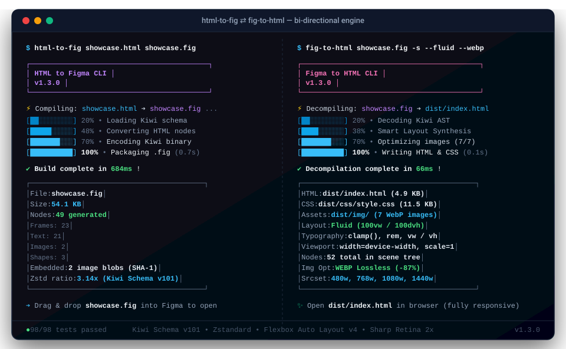

<div align="center">

# 🎨 HTML to .fig & .fig to HTML
### Figma Bi-Directional Engine 2.0

[](package.json)
[](https://opensource.org/licenses/MIT)
[](test/run-tests.js)
[](https://nodejs.org/)
[](https://www.figma.com)
[](https://github.com/KonstantinBelan/html-to-fig/pulls)

<p align="center">
  Высокопроизводительный двусторонний компилятор и декомпилятор нативных бинарных файлов Figma (<code>.fig</code>).<br>
  <b>HTML/CSS ➔ .fig</b> по спецификации <b>Kiwi Schema v101</b> и <b>.fig ➔ семантический адаптивный HTML5</b> с поддержкой Flexbox Auto Layout v4, Retina 2x, WebP/AVIF и Fluid-вёрстки.
</p>

<p align="center">
  <a href="#-демонстрация-cli">📺 Демонстрация CLI</a> •
  <a href="#-установка-и-быстрый-старт">🚀 Быстрый старт</a> •
  <a href="#-особенности-и-возможности">⚡ Возможности</a> •
  <a href="#-cli-справка">💻 CLI Справка</a> •
  <a href="#-программный-api-nodejs">🛠 API</a> •
  <a href="#-тестирование">🧪 Тесты</a>
</p>

</div>

---

## 📺 Демонстрация CLI

<p align="center">
  
</p>

<details>
<summary><b>Показать текстовый лог работы терминала</b></summary>

#### 1. Прямая конвертация: `html-to-fig`
```bash
$ html-to-fig showcase.html showcase.fig

┌──────────────────────────────────────────┐
│             HTML to Figma CLI            │
│               v1.2.0                     │
└──────────────────────────────────────────┘
⚡ Compiling: showcase.html -> showcase.fig...

✔ Build complete in 684ms!
┌─────────────────────────────────────────┐
│ File:       showcase.fig                │
│ Size:       54.1 KB                     │
│ Nodes:      49 generated                │
│   Frames:   23                          │
│   Text:     21                          │
│   Images:   2                           │
│   Shapes:   3                           │
│ Embedded:   2 image blobs               │
│ Zstd ratio: 3.14x                       │
└─────────────────────────────────────────┘

Drag and drop showcase.fig into Figma to open.
```

#### 2. Обратная конвертация с резиновой вёрсткой: `fig-to-html`
```bash
$ fig-to-html showcase.fig -s --fluid --webp

┌──────────────────────────────────────────┐
│             Figma to HTML CLI            │
│               v1.2.0                     │
└──────────────────────────────────────────┘
⚡ Decompiling: showcase.fig -> index.html (Fluid Layout)...

✔ Decompilation complete in 66ms!
┌─────────────────────────────────────────┐
│ HTML:       dist/index.html (4.9 KB)    │
│ CSS:        dist/css/style.css (11.5 KB)│
│ Assets:     dist/img/ (7 WebP images)   │
│ Layout:     Fluid (100vw / 100dvh)      │
│ Nodes:      52 total in fig             │
│ Img Opt:    WEBP Lossless (-87%)        │
└─────────────────────────────────────────┘

Open dist/index.html in any browser.
```
</details>

---

## ⚡ Особенности и возможности

- **100% нативный .fig формат**: Файлы открываются в Figma Desktop и Figma Web без плагинов — просто перетащите файл в окно Figma.
- **Конвертация всей страницы целиком**:
  - Трансляция начинается непосредственно с корня документа (`<body>`).
  - Сохраняются реальные размеры холста (например, вертикальные посты/слайды 1080×1350 или десктопные лэндинги) и фон страницы.
- **Современный Auto Layout v4 (Flexbox)**:
  - Чистая спецификация разметки без устаревших параметров: никаких предупреждений *"New auto layout version available"* в Figma.
  - Направления: `display: flex` / `inline-flex` (`flex-direction: row | column`).
  - Режимы сайзинга: **Hug contents** (`RESIZE_TO_FIT`), **Fixed** (`FIXED`), **Fill container** (`STRETCH`) по обеим осям (`stackPrimarySizing`, `stackCounterSizing`).
  - Выравнивание: `justify-content` (`flex-start`, `center`, `flex-end`, `space-between`, `space-evenly`).
  - Выравнивание по поперечной оси: `align-items` (`flex-start`, `center`, `flex-end`, `baseline`, `stretch`) с автоматическим растягиванием дочерних блоков.
  - Дочерние параметры: `flex-grow`, `align-self: stretch`, `position: absolute`.
  - Отступы: `gap`, `row-gap`, `column-gap`.
  - Независимые паддинги: 4 стороны (`padding-top/right/bottom/left`).
  - **Пре-компьютированный Layout Pass**: движок заранее рассчитывает физические размеры фреймов и координаты дочерних элементов (`transform.m02` / `transform.m12`), обеспечивая 100% совпадение позиционирования с браузером.
  - **Эмуляция отступов (margin) для текста**: поскольку текстовые слои в Figma не имеют собственных полей `margin`, элементы с внешними отступами автоматически оборачиваются в Auto Layout контейнеры с сохранением разметки.
- **Поддержка CSS Grid**:
  - `display: grid` и `inline-grid`: автоматический парсинг `grid-template-columns` (`repeat(N, 1fr)`, `repeat(N, 200px)`, `1fr 2fr` и др.).
  - Интеллектуальная трансляция сетки в Auto Layout v4 с `stackWrap: WRAP` и точным вычислением ширины ячеек.
  - Декомпиляция в семантический CSS Grid: флаг `--layout grid` / `--grid`.
- **Нативные Figma Variables и Design Tokens**:
  - **HTML ➔ .fig**: экспорт `:root` CSS-переменных в нативные бинарные коллекции Figma (`VARIABLE_SET` и `VARIABLE` узлы: `COLOR`, `FLOAT`, `STRING`).
  - **.fig ➔ HTML**: чтение переменных Figma и генерация CSS-переменных `:root` с поддержкой мульти-режимов тем (`[data-theme="Dark"]`).
  - Экспорт дизайн-токенов в JSON: флаг `--tokens [path]` / `--extract-tokens`.
- **Интерактивные состояния и варианты компонентов**:
  - Автоматическое распознавание псевдоклассов `:hover`, `:active`, `:focus` в CSS.
  - Генерация нативных взаимодействий Figma: `prototypeInteractions` с триггером `WHILE_HOVERING` и переходом `SWAP_STATE`.
  - Декомпиляция вариантов (`SYMBOL` со `State=Hover`, `State=Active`) в чистые CSS-псевдоклассы без дублирования HTML-разметки.
- **Типографика, Google Fonts и точные метрики**:
  - Автоматическое обнаружение Google Fonts из `<link>` и `@import url(...)` с формированием единого предзагрузочного тега.
  - Встроенная таблица метрик популярных семейств шрифтов (`FONT_METRICS_TABLE`: Inter, Roboto, Montserrat, Poppins, Fira Code и др.) для расчета размеров текста с точностью до долей пикселя.
  - Полная поддержка CSS Custom Properties (`var(--font-display)`, `var(--text-color)`) с каскадным разрешением значений из `:root` и поддержкой fallbacks.
  - Семейства шрифтов: `font-family`, автоматическое сопоставление со стандартными библиотеками шрифтов Figma (Inter, Plus Jakarta Sans, SF Pro Display и др.).
  - Точное квантование весов `font-weight` (100–900, с поддержкой промежуточных значений вроде `510` -> `500 Medium`).
  - Начертание: `font-style` (`italic`, `normal`).
  - Межстрочный интервал: `line-height` (множители вроде `1.04` -> `104%`, проценты, фиксированные пиксели `px`, `normal`).
  - Межбуквенный интервал: `letter-spacing` (`px`, `em`, `%`).
  - Выравнивание: `text-align` (`left`, `center`, `right`, `justify`).
  - Трансформация: `text-transform` (`uppercase`, `lowercase`, `capitalize`).
  - Оформление: `text-decoration` (`underline`, `line-through`, `none`).
  - **Rich Text**: смешанное форматирование внутри одного блока текста (`<b>`, `<i>`, `<span style="...">`, `<a>`) через `styleOverrideTable` и `characterStyleIDs`.
- **Цвета и заливки**:
  - HEX (3, 4, 6, 8 символов: `#rgb`, `#rgba`, `#rrggbb`, `#rrggbbaa`).
  - RGB и RGBA (`rgb(r, g, b)`, `rgba(r, g, b, a)`, современный синтаксис `rgb(255 0 0 / 50%)`).
  - HSL и HSLA (`hsl(h, s, l)`, `hsla(h, s, l, a)`).
  - Все 148 стандартных W3C именованных цветов (`crimson`, `aliceblue`, `transparent` и т.д.).
  - Динамический цвет `currentColor`.
- **Градиенты**:
  - `linear-gradient(...)`: математически точный расчёт 2x3 аффинной матрицы трансформации для любых углов (`deg`, `rad`, `turn`) и направлений (`to right`, `to bottom`, `to top right` и др.).
  - `radial-gradient(...)`.
  - Произвольное количество контрольных точек (color stops).
- **Скругления и границы**:
  - `border-radius`: единый радиус, 4 независимых угла (`border-top-left-radius` и др.), круг (`50%` -> `ELLIPSE`), пилюля (`9999px`).
  - Сглаживание углов (squircle / iOS smooth corners).
  - Границы: `border-width`, `border-style` (`solid`, `dashed`, `dotted`), `border-color`.
  - Независимые толщины сторон: `border-top-width`, `border-right-width`, `border-bottom-width`, `border-left-width`.
- **Эффекты, тени и режимы наложения**:
  - `box-shadow`: множественные тени, размытие `blur`, растяжение `spread`, смещение `offset`, а также внутренние тени `inset` (`INNER_SHADOW`).
  - Размытие слоев: `filter: blur(...)` (`FOREGROUND_BLUR`).
  - Размытие фона: `backdrop-filter: blur(...)` (`BACKGROUND_BLUR`).
  - Чистые режимы наложения: слои по умолчанию не засоряют инспектор свойств параметром `blendMode: NORMAL`, пока режим наложения явно не задан в CSS (`mix-blend-mode`).
- **Изображения и векторные иконки**:
  - ``: локальные файлы, base64 data URIs (`data:image/png;base64,...`), удаленные URL (`http://`, `https://`).
  - Определение реальных размеров из бинарных заголовков (PNG, JPEG, GIF, WebP, SVG).
  - Режимы заполнения: `object-fit: cover` (`FILL`), `contain` (`FIT`), `fill` (`STRETCH`).
  - Хеширование через SHA-1 и встраивание файлов в директорию `images/<sha1>` архива `.fig`.
  - `<svg>`: встроенные SVG элементы, векторные иконки и иллюстрации.
  - Поддержка `<use href="#id">` и SVG-спрайтов с сохранением обводок (`stroke`, `stroke-width`, `currentColor`) и заливок.
- **Формы и компоненты**:
  - Кнопки `<button>`, `a.btn`, `a.cta` (адаптивные Auto Layout фреймы с автоматическим Hug / Fixed сайзингом).
  - Поля ввода `<input type="text|email|password|search">` с плейсхолдерами и чистыми параметрами типографики.
  - Чекбоксы `<input type="checkbox">` и радиокнопки `<input type="radio">`.
  - Разделители `<hr>` (`LINE` ноды).
  - Таблицы `<table>`, `<tr>`, `<td>`, `<th>`.
  - Списки `<ul>`, `<ol>`, `<li>`.

### 🔄 Декомпилятор .fig ➔ HTML/CSS
- **📐 Интеллектуальный синтез адаптивной верстки (Layout Synthesis Engine)**:
  - **Полный отказ от `position: absolute`**: для макетов Figma, созданных дизайнерами **без единого Auto Layout**, движок автоматически группирует плоские абсолютные слои в гибкие Flexbox-контейнеры (`flex-direction: row | column`) и CSS Grid.
  - **Фаза 1. Spatial Normalization & Indexing**: точное вычисление 2D-габаритов (`BoundingBox`), пространственное индексирование и разрешение порядка наложения z-index.
  - **Фаза 2. Background & Container Induction**: автоматическое обнаружение прямоугольников-подложек (`RECTANGLE` с заливками, скруглениями или тенями), повышение их до семантических контейнеров и перенос стилей оформления на синтезированные `<div>` и `<button>` блоки.
  - **Фаза 3. Recursive XY-Cut & Fuzzy Clustering**: метод рекурсивного ортогонального разрезания пространства по 1D-профилям проекций с допуском неточностей дизайнера $\epsilon = 3\text{px}$ (Fuzzy Tolerance Clustering) для выравнивания строк, колонок и элементов (`align-items: center | flex-start`, `justify-content: space-between`).
  - **Фаза 4. Grid & Matrix Induction**: автоматическое распознавание регулярных матричных сеток карточек $N \times M$ и синтез нативного `display: grid; grid-template-columns: repeat(C, 1fr); column-gap: ...; row-gap: ...;`.
  - **Фаза 5. Flexbox Property Synthesis**: вычисление внутренних отступов (`padding`), промежутков (`gap`), правил растяжения (`align-self: stretch`, `width: 100%`) и изоляция декоративных оверлеев (`DECORATIVE_OVERLAY`).
  - **Управление через CLI**: флаг `--smart-layout` (включен по умолчанию) и `--no-smart-layout` для отката к абсолютному позиционированию при необходимости.
- **Режимы вёрстки и адаптивность (Fluid & Relative)**:
  - **Fluid (резиновая вёрстка)**: главный контейнер страницы растягивается на всю ширину (`width: 100vw; min-height: 100dvh;`), для типографики и отступов генерируются гибкие выражения `clamp()`, `min()`, `max()`, подключается `<meta name="viewport" content="width=device-width, initial-scale=1">`, а вместо фиксированных пикселей используются `rem`, `em`, `vw`, `vh`.
  - **Relative (относительные единицы)**: замена всех фиксированных `px` на относительные единицы `rem`, `em`, `vw`, `vh` для гармоничного масштабирования шрифтов и отступов.
  - **Default**: классическая фиксированная вёрстка с точным соответствием размерам в Figma в `px`.
- **Оптимизация и обработка изображений**:
  - Автоматическое масштабирование картинок по размеру в CSS с множителем x2 для идеального Retina-качества.
  - Генерация адаптивных атрибутов `srcset` и `sizes` под экраны смартфонов, планшетов и компьютеров (с возможностью отключения через `--no-srcset`).
  - Сжатие картинок без потери качества (Lossless) через Sharp/MozJPEG.
  - Конвертация в ультрасовременные форматы `WebP` и `AVIF`.
- **Полный CSS Reset**: генерация современного сброса стилей (`*, *::before, *::after { box-sizing: border-box; }`, сброс кнопок, полей ввода, списков, таблиц, ссылок), гарантирующий консистентное отображение во всех браузерах.
- **Поддержка компонентов и переопределений (Instance Overrides)**:
  - Автоматическое разрешение `INSTANCE` нод через клонирование мастер-компонентов (`SYMBOL`).
  - Полное применение `symbolOverrides` и `componentPropAssignments`: подмена текста, переопределение размеров, заливок, обводок, видимости, `letterSpacing`, `lineHeight`, `fontSize`, `fontName`, скруглений и вариантов начертания.
- **Реконструкция векторной графики (SVG)**:
  - Декодирование бинарных потоков `commandsBlob` и `VectorNetwork` в нативные SVG `<path>`.
  - Автоматическое объединение чисто векторных фреймов и групп в единые цельные `<svg>` иконки.
  - Пропорциональное масштабирование координат векторов (`scale(sx, sy)`) под реальный размер фрейма.
  - Атрибут `vector-effect="non-scaling-stroke"` для защиты толщины линий от искажений при масштабировании.
- **Маски и замаскированные группы (Masking)**:
  - Автоматическое определение маскирующих слоев (`mask: true`).
  - Применение формы и скруглений маски к родительскому контейнеру (`overflow: hidden; border-radius: ...`).
  - Сохранение нормального потока замаскированного содержимого (`width: 100%; height: 100%; object-fit: cover`) без выпадения в абсолютное позиционирование.
- **Прецизионный Auto Layout и Flexbox**:
  - Чёткое разделение основной и поперечной осей (`isRow` vs `!isRow`).
  - Сохранение фиксированных размеров на основной оси при растяжении (`align-self: stretch`) по поперечной (например, `width: 256px` у растянутого сайдбара).
  - Поддержка режимов **Hug contents** (отсутствие жестких `width`/`height`), **Fixed** (`px`), и **Fill container** (`flex: 1`).
  - Автоматическое вертикальное центрирование текста при `textAlignVertical: CENTER`.
- **Типографика и обрезка текста**:
  - Поддержка множителей `line-height` (единицы `RAW`, `PERCENT`, `PIXELS`).
  - Межбуквенный интервал `letter-spacing` (относительные `em` и фиксированные `px`, включая отрицательные значения вроде `-3%` -> `-0.03em`).
  - Параметр **Truncate text** из Figma: генерация `text-overflow: ellipsis; white-space: nowrap; overflow: hidden; min-width: 0`.
- **Типизированные `:root` CSS-переменные**:
  - Контекстно-зависимая группировка: радиусы (`--radius-*`), цвета (`--color-*`), шрифты (`--font-*`), габариты холстов (`--slide-*`).
  - Исключение случайной подстановки переменных одного типа в свойства другого (например, радиусов в ширину или отступы).

---

## 🚀 Установка и быстрый старт

### Запуск через CLI

#### 1. Прямая конвертация: HTML ➔ .fig
```bash
# Простой запуск для HTML файла:
node cli.js index.html

# Указание имени выходного файла:
node cli.js landing.html landing.fig

# Или через npm script:
npm run build
```

#### 2. Обратная конвертация: .fig ➔ HTML
```bash
# Декомпиляция .fig файла в чистый автономный HTML (Retina 2x + адаптивный srcset / sizes):
node cli-reverse.js design.fig

# Полноценная резиновая (fluid) вёрстка на всю ширину (100vw / 100dvh, clamp(), min(), max(), rem):
node cli-reverse.js design.fig index.html --fluid

# Использование относительных единиц измерения (rem, em, vw, vh вместо px):
node cli-reverse.js design.fig index.html --relative

# Декомпиляция с генерацией адаптивной CSS Grid сетки вместо Flexbox:
node cli-reverse.js design.fig index.html --grid
# или:
node cli-reverse.js design.fig index.html --layout grid

# Экспорт нативных Figma Variables в файл дизайн-токенов JSON (W3C Design Tokens format):
node cli-reverse.js design.fig index.html --tokens tokens.json

# Декомпиляция с вынесением CSS в отдельный файл css/style.css и картинок в img/*:
node cli-reverse.js design.fig -s
# или:
node cli-reverse.js design.fig index.html --separate-files

# Резиновая вёрстка с отдельными WebP картинками и внешним CSS:
node cli-reverse.js design.fig index.html -s --fluid --webp

# Экспорт с картинками в современном формате WebP:
node cli-reverse.js design.fig index.html -s --webp

# Экспорт с картинками в формате AVIF и сжатием без потери качества (lossless):
node cli-reverse.js design.fig index.html -s --avif --compress

# Отключение адаптивного srcset (генерирует единую четкую 2x Retina картинку в src):
node cli-reverse.js design.fig index.html --no-srcset

# Декомпиляция макетов без Auto Layout в чистый Flexbox/Grid (включено по умолчанию):
node cli-reverse.js unorganized.fig index.html

# Принудительный откат к традиционному position: absolute:
node cli-reverse.js unorganized.fig index.html --no-smart-layout

# Указание имени выходного файла и страницы:
node cli-reverse.js showcase.fig output.html --page "Page 1"

# Тонкая настройка путей к CSS и картинкам:
node cli-reverse.js test/hard.fig index.html --extract-css --css-file styles/main.css --assets-dir assets

# Умный автовыбор направления через общую команду:
node cli.js design.fig # автоматически определит .fig и создаст design.html
```

Вы также можете связать утилиты глобально:
```bash
npm link
html-to-fig input.html output.fig
fig-to-html input.fig output.html
```

---

## 💻 CLI Справка

### html-to-fig
```text
USAGE:
  $ html-to-fig <input.html|.fig> [output] [options]
  $ html-to-fig -i <input.html> -o <output.fig>

ARGUMENTS:
  <input>           Путь к исходному HTML или .fig файлу
  [output]          Путь к создаваемому файлу (по умолчанию: <имя-файла>.fig или .html)

OPTIONS:
  -i, --input <file>       Входной файл
  -o, --output <file>      Выходной файл
  -t, --template <file>    Файл шаблона .fig (по умолчанию: templates/template.fig)
  -p, --page <name>        Имя страницы в Figma (по умолчанию: "Page 1")
  -w, --watch              Режим наблюдения (автосборка при изменении)
  --no-remote-images     Отключить скачивание внешних картинок (HTTP/HTTPS)
  -v, --verbose            Подробные логи процесса сборки
  -h, --help               Справка по командам
  -V, --version            Версия утилиты
```

### fig-to-html
```text
USAGE:
  $ fig-to-html <input.fig> [output.html] [options]
  $ fig-to-html -i <input.fig> -o <output.html>

OPTIONS:
  -i, --input <file>       Входной .fig файл
  -o, --output <file>      Выходной .html файл
  -p, --page <name>        Имя страницы в Figma (по умолчанию: "Page 1")
  -w, --watch              Режим наблюдения (авторебилд при изменении .fig)
  -s, --separate-files     Извлекать отдельный CSS (css/style.css) и картинки (img/*)
  --extract-css            Вынести стили в отдельный .css файл вместо <style> в <head>
  --css-file <path>        Путь для внешнего файла стилей (по умолчанию: "css/style.css")
  --no-inline-images       Извлекать изображения в отдельные файлы вместо Base64
  --assets-dir <dir>       Папка для извлеченных картинок (по умолчанию: "img")
  --inline-styles          Генерировать инлайн-атрибуты style="..." вместо классов
  --image-scale <n>        Множитель размера картинок от размера в CSS (по умолчанию: 2 для Retina x2)
  --no-srcset              Отключить адаптивный srcset / sizes для разных устройств
  -c, --compress           Сжатие изображений без потери качества (lossless)
  --format <fmt>           Конвертация в современный формат: webp, avif, original (по умолчанию: original)
  --webp                   Шорткат для --format webp
  --avif                   Шорткат для --format avif
  --layout <mode>          Режим вёрстки: default (px), relative (rem/em/vw/vh), fluid (clamp/min/max) или grid
  --fluid                  Шорткат для --layout fluid (100vw/100dvh, clamp(), rem, vw/vh)
  --relative, --rem        Шорткат для --layout relative (rem, em, vw/vh вместо px)
  --grid                   Шорткат для --layout grid (CSS Grid разметка)
  --tokens [path]          Экспорт Figma Variables в файл дизайн-токенов JSON (по умолчанию: tokens.json)
  --smart-layout           Синтез адаптивного Flexbox/Grid без position: absolute (по умолчанию: включен)
  --no-smart-layout        Отключить синтез разметки и использовать абсолютное позиционирование
  -v, --verbose            Подробные логи процесса
  -h, --help               Справка по командам
  -V, --version            Версия утилиты
```

---

## 🛠 Программный API (Node.js)

Вы можете использовать библиотеку в своих скриптах и бэкендах для обоих направлений:

### Прямая конвертация (HTML ➔ .fig)
```javascript
const { generateFigFile } = require('html-to-fig');

async function build() {
    const result = await generateFigFile({
        htmlPath: 'test/hard.html',
        outputPath: 'output.fig',
        templatePath: 'templates/template.fig', // опционально
        pageName: 'Page 1',
        verbose: true
    });

    console.log(`Создано ${result.generatedNodes} нод за ${result.durationMs}мс!`);
    console.log(`Файл: ${result.outputPath} (${result.fileSizeBytes} байт)`);
}

build();
```

### Обратная конвертация (.fig ➔ HTML)
```javascript
const { convertFigToHtml } = require('html-to-fig');

async function decompile() {
    // 1. Автономный единый HTML файл (все стили в <head><style>, картинки в Base64):
    const result1 = await convertFigToHtml('showcase.fig', {
        outputHtmlPath: 'output.html',
        pageName: 'Page 1',
        inlineImages: true,
        verbose: true
    });

    // 2. Модульная структура с отдельным CSS (css/style.css), картинками WebP и сжатием без потерь:
    const result2 = await convertFigToHtml('showcase.fig', {
        outputHtmlPath: 'dist/index.html',
        separateFiles: true, // создает dist/css/style.css и dist/img/*
        imageScale: 2,       // масштабирование под CSS размер x2 для Retina качества
        responsiveImages: true, // генерация srcset и sizes под разные устройства
        compress: true,      // сжатие без потери качества (lossless)
        imageFormat: 'webp', // современные форматы: 'webp', 'avif' или 'original'
        verbose: true
    });

    // 3. Полноценная резиновая (fluid) вёрстка на всю ширину страницы:
    const result3 = await convertFigToHtml('showcase.fig', {
        outputHtmlPath: 'dist/fluid.html',
        layoutMode: 'fluid', // 'fluid' (100vw, 100dvh, clamp, min, max, rem) | 'relative' (rem, em, vw, vh) | 'default' (px)
        separateFiles: true,
        imageFormat: 'webp',
        verbose: true
    });

    console.log(`Декомпилировано ${result2.totalNodes} нод за ${result2.durationMs}мс!`);
    console.log(`HTML: ${result2.outputPath}, CSS: ${result2.cssPath}, Assets: ${result2.assetsDir}`);
}

decompile();
```

---

## 🧪 Тестирование

Проект покрыт всесторонними автоматическими тестами (84 теста):
- Парсинг цветов (HEX, RGB, RGBA, HSL, HSLA, named, modern space-slash syntax, alpha)
- Линейные и радиальные градиенты, расчёт и обратный пересчет углов матриц трансформации
- Тени (drop-shadow, inset, multiple, zero spread) и фильтры размытия
- Типографика (font-weight, style, line-height multipliers, letter-spacing, Rich Text)
- Определение габаритов изображений и хеширование SHA-1
- Сквозная генерация и проверка валидности структуры декодером Figma Kiwi
- Тестирование на сложных реальных макетах (`test/showcase.html` и `test/hard.html`)
- Декомпиляция .fig в валидный адаптивный HTML с сохранением семантики, Flexbox и графики
- Автоматическое формирование `:root` переменных и семантических классов слоев с транслитерацией
- Определение форматов изображений по Magic Bytes и экспорт раздельных файлов (`css/style.css`, `img/*`)
- Изменение размера изображений по размеру в CSS с множителем x2 для лучшего Retina-качества
- Добавление адаптивных размеров под разные устройства (mobile, tablet, desktop) через `srcset` и `sizes`
- Возможность отключения `srcset` / `sizes` через параметр CLI (`--no-srcset`)
- Сжатие размера и качества картинок без потери качества (lossless, mozjpeg, webp/avif lossless)
- Конвертация изображений в современные медиа-форматы (`WebP`, `AVIF`) через параметры CLI
- Относительные единицы измерения (`rem`, `em`, `vw`, `vh`) вместо фиксированных `px` (`--relative`, `--rem`)
- Полноценная резиновая (fluid) вёрстка на всю ширину страницы (`width: 100vw; min-height: 100dvh;`) с функциями `min()`, `max()`, `clamp()` (`--fluid`)
- Добавление `<meta name="viewport" content="width=device-width, initial-scale=1">` для полной мобильной адаптивности
- Полный Round-Trip тест: HTML ➔ .fig ➔ HTML с проверкой целостности всех элементов
- Декодирование бинарных `commandsBlob` и `VectorNetwork` в масштабируемые SVG пути
- Сохранение фиксированных габаритов Auto Layout при растяжении по поперечной оси (`align-self: stretch`)
- Полная поддержка `symbolOverrides` для инстансов компонентов (подмена текста, переопределения `letter-spacing`, `line-height` и стилей)
- Корректная обработка масок и встраивание замаскированных картинок в поток документа
- Поддержка нативных переменных Figma (`VARIABLE_SET`, `VARIABLE`) и экспорт дизайн-токенов в JSON (`--tokens`)
- Трансляция CSS Grid (`repeat(N, 1fr)`) в Auto Layout Wrap и обратная декомпиляция (`--layout grid`, `--grid`)
- Генерация интерактивных связей прототипа (`prototypeInteractions`) для состояний `:hover`
- Трансляция Figma Auto line-height (100% или AUTO) в нативный CSS `line-height: normal` (вместо жесткого `1`)
- Автоматическое обнаружение Google Fonts и расчет размеров текста по таблице метрик `FONT_METRICS_TABLE`
- Оптимизация памяти при чтении бинарных `.fig` (ленивое декодирование изображений в Base64)
- **Layout Synthesis Engine**:
  - Геометрические операции `BoundingBox`: вычисление пересечений, объединений, расстояний и частичных перекрытий границ
  - 1D-проекции и нечеткая кластеризация интервалов (Fuzzy Interval Clustering, $\epsilon = 3\text{px}$)
  - Детекция карточек-подложек и повышение прямоугольников до семантических контейнеров с переносом стилей
  - Изоляция декоративных оверлеев (бейджи, кнопки закрытия) с сохранением локального `position: absolute`
  - Распознавание $N \times M$ матричных сеток элементов с равномерным шагом и отступами
  - Рекурсивный синтез разметки Recursive XY-Cut: построение колонок и строк Flexbox с автоматическим вычислением gap и padding
  - Равномерное адаптивное распределение `flex: 1` для карточек и элементов равной ширины с поддержкой смешанных строк (outlier items сохраняют фиксированную ширину)
  - Приоритет верхнего выравнивания (`align-items: flex-start`) для строк карточек и блоков при совпадении верхних границ (`allTopsAligned`) для аккуратной адаптивности при разной высоте контента
  - Снятие избыточных `width` и `height` с кнопок (`.btn-*`, `button`) и синтезированных строк/контейнеров
  - Корректная иерархия наложения абсолютных оверлеев с назначением `z-index` (>= 10) над контентом карточек и предотвращением обрезки через `overflow: hidden`
  - Предварительная изоляция выступающих за границы холста или перекрывающих элементы оверлеев, предотвращающая искажение внутренних отступов (`padding`) контейнеров
  - Поддержка настроек цветокоррекции изображений Figma (`paintFilter`: Exposure, Contrast, Saturation, Temperature, Tint) с трансляцией в CSS `filter`
  - Адаптивный резиновый корневой контейнер `.main-container` с `max-width` вместо фиксированного `width`
  - Интеллектуальный расчет ритма секций: при неравномерных зазорах дочерним блокам назначаются точечные `margin-top` вместо искусственного общего `gap`
  - Парсинг CLI-флагов `--smart-layout` и `--no-smart-layout`
  - End-to-End декомпиляция макетов без единого Auto Layout фрейма в чистый Flexbox и CSS Grid без `position: absolute`
  - Проверка сохранения традиционного абсолютного позиционирования при флаге `--no-smart-layout`

Запуск тестов:
```bash
npm test
```

---

## 📁 Структура проекта

```text
html-to-fig/
├── cli.js                  # Главный CLI интерфейс (HTML -> FIG и автодетекция)
├── cli-reverse.js          # CLI интерфейс декомпилятора (FIG -> HTML)
├── index.js                # Главная точка входа программного API (двусторонний)
├── package.json            # Зависимости и метаданные проекта
├── docs/
│   └── cli-demo.svg        # Векторная демонстрация работы терминала (SVG)
├── templates/
│   └── template.fig        # Эталонный бинарный шаблон Figma контейнера
├── src/
│   ├── generator.js        # Оркестратор сборки бинарного .fig (Kiwi + Zstd)
│   ├── converter.js        # HTML/CSS -> Figma AST транслятор (Auto Layout, Layout Pass)
│   ├── schema.js           # Компилятор и кэш Kiwi схемы
│   ├── decompiler/         # ДВИЖОК ОБРАТНОЙ КОНВЕРТАЦИИ (FIG -> HTML)
│   │   ├── index.js        # Главный оркестратор декомпиляции
│   │   ├── geometry.js     # BoundingBox, 1D-проекции, Fuzzy Clustering и интервалы
│   │   ├── container-detector.js # Обнаружение карточек-подложек и изолирование оверлеев
│   │   ├── synthesizer.js  # Recursive XY-Cut, детекция сеток N x M и Auto Layout синтез
│   │   ├── reader.js       # Чтение .fig ZIP, декомпрессия Kiwi и извлечение картинок
│   │   ├── tree.js         # Восстановление иерархии сцены, инстансы компонентов и overrides
│   │   ├── stylesheet.js   # Менеджер CSS-классов, генерация :root переменных, дедупликация и транслитерация
│   │   ├── css.js          # Трансляция Figma AST стилей в чистый CSS и маппинг MIME типов
│   │   ├── units.js        # Преобразование единиц (rem, em, vw, vh) и fluid-расчеты (clamp, min, max)
│   │   ├── html.js         # Генерация семантического HTML5, форм и Rich Text
│   │   └── vector.js       # Декодирование бинарных VectorNetwork и commandsBlob в SVG
│   ├── parsers/
│   │   ├── color.js        # Парсер всех типов CSS цветов
│   │   ├── gradient.js     # Парсер линейных и радиальных градиентов
│   │   ├── effects.js      # Парсер теней и размытий
│   │   ├── typography.js   # Шрифты, стили текста, CSS переменные, габариты
│   │   ├── images.js       # Реестр изображений, SHA-1, base64, remote fetch
│   │   └── svg.js          # Обработчик встроенного SVG и <use> символов
│   └── utils/
│       └── guid.js         # Генератор GUID и лексикографических индексов
└── test/
    ├── run-tests.js        # Автоматический тестовый запуск (84 теста)
    ├── test.html           # Базовый тестовый HTML
    ├── showcase.html       # Демонстрационный макет со всеми базовыми фичами
    └── hard.html           # Сложный макет (Instagram deck, CSS vars, SVG use, сетки)
```

---

## 📄 Лицензия

MIT
