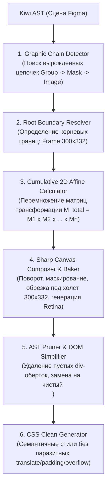

# 🖼 Спецификация Enterprise Graphic Subtree Collapsing & Cumulative Baking Engine
## Автоматическое схлопывание избыточных цепочек групп и кумулятивное запекание составной графики в единые ассеты

> **Статус**: Архитектурная спецификация (Ready for Implementation)  
> **Целевая версия**: `html-to-fig` v1.5.0  
> **Область применения**: Декомпилятор Figma `.fig` ➔ HTML/CSS (`src/decompiler/`)

---

## 1. Проблема и бизнес-контекст

### 1.1. Избыточная вложенность («Divitis») в макетах Figma
В графических редакторах (в первую очередь Figma) дизайнеры часто организуют иллюстрации и сложные графические композиции через многоуровневые вложенные группы. В процессе работы над макетом дизайнер:
1. Помещает фотографию в группу (`Group`);
2. Создает векторный слой для маскирования и оборачивает их в группу маски (`Mask group`);
3. Поворачивает полученную композицию (например, наклон бутылки на $-15^\circ$);
4. Оборачивает повернутую маску в еще одну группу (`Group`) для позиционирования;
5. Помещает всё это в экранный фрейм-карточку (`Frame`), имеющий свойства AutoLayout, паддинги и `overflow: hidden`.

Пример реальной структуры из макета `test/demo/jetlife/jetlife.fig`:
```
Frame 116047416 (карточка товара / окно иллюстрации, 300×332px)
  └── Group 116047490 (габариты 527×520px)
        └── Mask group 5 (габариты 432×423px, transform: rotate(-15deg))
              └── Group 116047492
                    └── Gemini_Generated_Image... (исходный растр 1138×1138px)
```

### 1.2. Почему наивный перенос 1-в-1 в HTML/CSS ломает верстку
Если декомпилятор транслирует каждый виртуальный слой Figma в отдельный `<div>`, возникает каскадный сбой рендеринга:

1. **Конфликт CSS Box Model и Padding**:
   Родительский `Frame 116047416` имеет `padding: 24px; display: flex; flex-direction: column; overflow: hidden;`. В спецификации CSS абсолютно позиционированный дочерний элемент фрейма с Flexbox/AutoLayout позиционируется относительно `padding-box`, что сдвигает все дочерние группы на **+24px** по X и Y.
2. **Наложение стековых контекстов и сдвигов**:
   Каждая промежуточная группа вносит свой локальный `transform`, `transform-origin`, `position: absolute` и отрицательные координаты (`translate(-68.5px, -83.3px)`).
3. **Размытие и потеря точности**:
   Многократный рантайм-рендеринг вложенных `rotate()` и `overflow: hidden` на GPU мобильных и десктопных браузеров приводит к субпиксельным неточностям и мылу.
4. **Визуальный результат**:
   В браузере наклонная бутылка оказывается смещенной, увеличенной и упирается в верхний край карточки, тогда как в Figma она аккуратно спозиционирована и отцентрирована внутри фрейма `300×332px`.

### 1.3. Цель движка
Создать специализированный модуль **Graphic Subtree Collapsing & Cumulative Baking**, который:
1. Распознает «вырожденные» ветки в дереве слоев Figma, не несущие смысловой нагрузки разметки (в которых нет текста, кнопок или нескольких параллельных элементов интерфейса, а есть только обертки вокруг одного графического ассета);
2. Математически аккумулирует все вложенные трансформации (повороты, масштабирования, смещения, маски) в единую кумулятивную 2D-матрицу относительно корневого графического контейнера;
3. Запекает итоговую композицию через Sharp в **один высококачественный прозрачный PNG-ассет** (с поддержкой Retina `@1x`, `@2x`, `@3x`);
4. Схлопывает 4–6 вложенных `<div>` в дереве DOM в **один чистый семантический тег ``** (или компактный контейнер с ``).

---

## 2. Архитектура движка (Pipeline)



---

## 3. Математика кумулятивных трансформаций (2D Affine Math)

В Figma каждый узел сцены хранит матрицу относительного расположения `relativeTransform` в виде массива `[ [a, c, tx], [b, d, ty] ]`, что соответствует матрице 2D-аффинного преобразования:

$$M = \begin{pmatrix} a & c & t_x \\ b & d & t_y \\ 0 & 0 & 1 \end{pmatrix}$$

Где:
- $a = S_x \cdot \cos\theta$
- $b = S_x \cdot \sin\theta$
- $c = -S_y \cdot \sin\theta$
- $d = S_y \cdot \cos\theta$
- $t_x, t_y$ — линейный сдвиг (Translation) по осям X и Y.

### 3.1. Кумулятивная композиция по цепочке предков
Если листовое изображение $I$ находится внутри цепочки узлов $K_1 \to K_2 \to \dots \to K_n \to I$, то положение точки $(x, y)$ изображения в координатной системе корневого контейнера $K_1$ выражается произведением матриц:

$$M_{\text{cumulative}} = M_{K_1 \to K_2} \times M_{K_2 \to K_3} \times \dots \times M_{K_n \to I}$$

### 3.2. Разложение кумулятивной матрицы (Decomposition)
Из итоговой матрицы $M_{\text{cumulative}} = \begin{pmatrix} a & c & t_x \\ b & d & t_y \\ 0 & 0 & 1 \end{pmatrix}$ извлекаются параметры для запекания:
- **Угол поворота**:
  $$\theta = \text{atan2}(b, a)$$
- **Масштаб по осям**:
  $$S_x = \sqrt{a^2 + b^2}, \quad S_y = \sqrt{c^2 + d^2}$$
- **Смещение центра**:
  $$T_x = t_x, \quad T_y = t_y$$

### 3.3. Расчет холста и экстракции (Canvas & Bounding Box)
Пусть корневой фрейм имеет размеры $W_{\text{root}} \times H_{\text{root}}$ (например, $300 \times 332$).
1. Создается прозрачный холст целевого разрешения: $W = W_{\text{root}} \cdot \text{scale}$, $H = H_{\text{root}} \cdot \text{scale}$ (где $\text{scale} = 2$ для `@2x`).
2. Исходный растр масштабируется с коэффициентом $S_x, S_y$ и поворачивается через Sharp:
   ```javascript
   sharp(imageBuffer)
     .resize(Math.round(origW * Sx * scale), Math.round(origH * Sy * scale))
     .rotate(thetaDegrees, { background: { r: 0, g: 0, b: 0, alpha: 0 } })
   ```
3. Вычисляется сдвиг повернутого изображения относительно верхнего левого угла корневого холста. Если повернутое изображение выходит за границы холста, Sharp производит наложение (`composite`) или извлечение фрагмента (`extract`), строго совпадающего с рамкой $W_{\text{root}} \times H_{\text{root}}$.

---

## 4. Алгоритм детекции цепочек (Pattern Matching)

Алгоритм должен строго отличать **вырожденные графические цепочки** от **структурной верстки**.

### 4.1. Критерии вырожденной графической цепочки (`isGraphicSubtreeChain`)
Цепочка $N_{\text{root}} \to C_1 \to \dots \to C_k \to \text{Leaf}$ считается вырожденной графической веткой, если выполняются **все** условия:

1. **Единственный визуальный контент**:
   На каждом шаге от $N_{\text{root}}$ до $\text{Leaf}$ каждый промежуточный узел $C_i$ имеет ровно **одного** дочернего потомка (или двух, если один из них является маской `isMask: true`).
2. **Отсутствие интерактивных и текстовых узлов**:
   Ни в одном узле цепочки нет текста (`TEXT`), компонентов ввода (`INPUT`), ссылок или нескольких параллельных смысловых блоков.
3. **Листовой узел — это растровое изображение**:
   Конечный потомок $\text{Leaf}$ содержит заливку типа `IMAGE`.
4. **Наличие паразитной сложности**:
   Внутри цепочки присутствует хотя бы одно из условий:
   - Слой маски (`isMask: true`);
   - Поворот (`rotation != 0` или матрица с $b \neq 0, c \neq 0$);
   - Глубина вложенности групп $\ge 2$.

### 4.2. Определение границ схлопывания (Root Boundary)
- **Вариант А (Фрейм является чистой графической карточкой)**:
  Если у $N_{\text{root}}$ нет видимого фона (`fills` пусты), нет бордеров (`strokes`), нет текста, а размер фрейма совпадает с габаритами иллюстрации в сетке — сам $N_{\text{root}}$ заменяется на тег ``.
- **Вариант Б (Фрейм имеет собственный фон, бордер или тень)**:
  Если у $N_{\text{root}}$ есть свой `background-color`, `border-radius`, тень или он участвует в родительской сетке AutoLayout — $N_{\text{root}}$ сохраняется как `<div class="card">`, а все его внутренние промежуточные группы схлопываются в **один вложенный тег** ``.

---

## 5. До и После: Сравнение верстки

### 5.1. До внедрения (текущий проблемный вывод)

#### HTML (`index.html`):
```html
<div class="frame-116047416-6">
  <div class="group-116047490">
    <div class="mask-group-5">
      <div class="group-116047492">
        
      </div>
    </div>
  </div>
</div>
```

#### CSS (`style.css`):
```css
.frame-116047416-6 {
  display: flex;
  flex-direction: column;
  padding: 24px;
  position: absolute;
  left: 360px;
  top: 0px;
  width: 300px;
  height: 332px;
  overflow: hidden;
}
.group-116047490 {
  position: absolute;
  left: 0;
  top: 0;
  width: 527px;
  height: 520px;
}
.mask-group-5 {
  position: absolute;
  transform: rotate(-15deg) translate(-68.5px, -83.3px);
  width: 432px;
  height: 423px;
}
.gemini_generated_image_c1xrnjc1xrnj {
  position: absolute;
  width: 1138px;
  height: 1138px;
  max-width: none;
}
```
*Результат*: 5 уровней DOM, смещение из-за `padding: 24px`, обрезание верхушки бутылки.

---

### 5.2. После внедрения движка (целевой результат)

#### HTML (`index.html`):
```html

```

#### CSS (`style.css`):
```css
.frame-116047416-6 {
  position: absolute;
  left: 360px;
  top: 0px;
  width: 300px;
  height: 332px;
  object-fit: contain;
  pointer-events: none;
}
```
*Результат*:
- 1 семантический тег `` вместо 5 вложенных контейнеров;
- 0% искажений и смещений — позиция пиксель-в-пиксель соответствует макету Figma;
- Отсутствие рантайм-нагрузки на GPU браузера;
- Идеальная четкость на Retina экранах.

---

## 6. Граничные случаи и отказоустойчивость (Edge Cases)

| Граничный случай | Поведение алгоритма |
|---|---|
| Внутри группы есть текст (`TEXT`) или кнопка | **Не схлопывать**. Цепочка не считается вырожденной, верстается стандартными вложенными `<div>`. |
| Группа содержит 2 и более не-масочных слоя | **Не схлопывать**. Это многослойная композиция интерфейса. |
| Слой маски векторный (звезда, многоугольник, кривые Безье) | Векторная маска растеризуется через SVG-буфер и накладывается через Sharp `composite` с оператором `dest-in` перед обрезкой. |
| Контейнер $N_{\text{root}}$ имеет градиентный фон или тень `box-shadow` | $N_{\text{root}}$ сохраняется как внешний `<div>` со своими стилями, а схлопывание происходит для его внутренних групп, помещая внутрь один чистый ``. |
| Изображение имеет свойства `paintFilter` (контраст/экспозиция) или мульти-заливки | Фильтры и заливки применяются первым шагом через существующий `bakeImageFillsAndFilters`, после чего результирующий буфер поступает в кумулятивное запекание. |

---

## 7. Пошаговый план реализации (Phased Implementation Plan)

### Фаза 1: Модуль аффинной геометрии и детекции (`src/decompiler/graphic-collapser.js`)
1. Создать функции перемножения 2D-аффинных матриц:
   - `multiplyAffineMatrices(m1, m2)`
   - `decomposeAffineMatrix(m)` ➔ `{ rotateDeg, scaleX, scaleY, translateX, translateY }`
2. Реализовать предикат `detectGraphicSubtreeChain(node)` для обхода AST Kiwi:
   - Поиск цепочек `FRAME/GROUP -> ... -> IMAGE`.
   - Проверка отсутствия семантических потомков (`TEXT`, интерактивные узлы).
   - Вычисление корневых границ (`boundaryBox: { width, height, x, y }`).

### Фаза 2: Пайплайн композиции и запекания в Sharp
1. Добавить функцию `bakeGraphicChainAsset(chainInfo, rawImages, options)` в `src/decompiler/image-optimizer.js`:
   - Применение масштаба и угла поворота к буферу исходного изображения;
   - Растеризация маски (если есть);
   - Точная обрезка / экстракция под размеры корневого холста ($W \times H$);
   - Генерация Retina-версий (`@1x`, `@2x`);
   - Сохранение запеченного PNG-буфера в `rawImages` с новым хешем.

### Фаза 3: Схлопывание в AST (DOM Tree Simplification)
1. В `src/decompiler/tree.js` или перед этапом генерации HTML:
   - Заменять цепочку промежуточных узлов на единый узел с типом `IMAGE` (или обновлять корневой узел, назначая ему флаг `isCollapsedGraphicRoot = true`);
   - Удалять из дерева дочерние псевдо-группы, предотвращая генерацию пустых `<div>`.

### Фаза 4: Синхронизация генератора CSS (`src/decompiler/css.js`)
1. Для схлопнутых узлов (`isCollapsedGraphicRoot`):
   - Подавлять генерацию внутренних Flex/Padding свойств;
   - Задавать габариты `width`, `height`, `object-fit: contain`;
   - Исключать генерацию лишних селекторов для удаленных классов групп.

### Фаза 5: Валидация и тестирование
1. Запуск полного регрессионного сьюта:
   ```bash
   node test/run-tests.js
   ```
   Все 119 существующих тестов должны проходить успешно (`119/119 passed`).
2. Добавление специализированного теста на схлопывание:
   - Тест на вычисление матрицы поворота $-15^\circ$;
   - Тест на определение вырожденной цепочки групп;
   - Тест на сохранение узлов с текстом (защита от ложных срабатываний).
3. Пересборка макета `test/demo/jetlife/jetlife.fig`:
   - Проверка карточки `.frame-116047416-6` в `test/demo/jetlife/index.html`;
   - Визуальное подтверждение совпадения со Скрином 3 из Figma.
