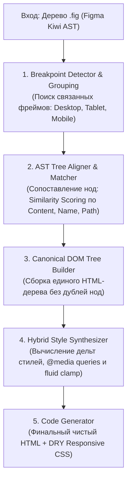
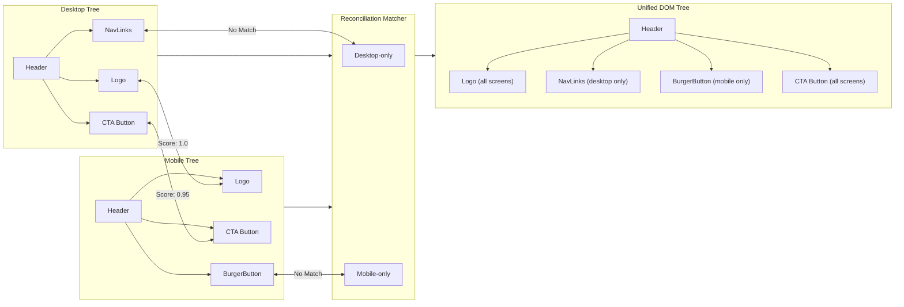

# 📱 Спецификация Figma Adaptive Multi-Breakpoint Engine (v1.4.0)
## Кросс-девайсная адаптивная верстка из нескольких фреймов Figma в единый responsive HTML/CSS сайт

> **Цель версии 1.4.0**: Разработка и внедрение **Adaptive Multi-Breakpoint Engine** — интеллектуального механизма, способного объединять несколько связанных экранных фреймов Figma (Desktop, Tablet, Mobile) в **одно каноническое адаптивное HTML-дерево** с единым оптимизированным CSS-файлом, использующим современные **CSS Media Queries** и бесшовную **Fluid интерполяцию (`clamp()`)**.

---

## 1. Проблема и контекст

### 1.1. Текущее положение дел
В версии v1.3.0 проект `html-to-fig` научился экспортировать многостраничные сайты, но каждый экранный фрейм Figma обрабатывается как **отдельная независимая страница** (`index.html`, `about.html`, `mobile.html`).

В реальной веб-разработке дизайнеры рисуют **один и тот же экран** под 2–4 разрешения:
- **Desktop**: 1440px / 1920px (развернутая навигация, многоколоночные сетки, крупные заголовки)
- **Tablet / Laptop**: 768px / 1024px (2-колоночные сетки, уменьшенные отступы)
- **Mobile**: 375px / 390px (1-колоночный стек, гамбургер-меню, компактная типографика)

### 1.2. Проблема существующих конвертеров
Все существующие инструменты на рынке (Anima, Locofy, TeleportHQ и плагины Figma) при попытке экспортировать Desktop и Mobile сталкиваются с фундаментальной дилеммой:
1. Либо генерируют **разные несвязанные HTML-страницы** (`desktop.html`, `mobile.html`), что делает невозможной публикацию единого адаптивного сайта;
2. Либо дублируют все узлы внутри одного HTML-файла, скрывая целые экраны через `display: none !important`, что приводит к раздуванию DOM в 3 раза, ухудшению SEO, скачкам LCP/CLS и двойной загрузке изображений.

### 1.3. Наше решение
**Adaptive Multi-Breakpoint Engine v1.4.0** производит **семантическое слияние (Reconciliation)** деревьев разных брейкпоинтов:
- Создается **ровно один семантический HTML-тег** для каждого логического элемента.
- Стили десктопа берутся за базу (Desktop-first) либо стили мобайла (Mobile-first).
- Различия в структуре оформляются через медиа-запросы `@media`.
- Различия в числовых параметрах (размеры шрифтов, паддинги, гэпы) плавно интерполируются через математические функции `clamp()`.
- Уникальные для брейкпоинтов элементы (например, десктопное меню vs бургер-кнопка) переключаются через чистый `display: none` / `display: flex`.

---

## 2. Архитектура движка (Adaptive Pipeline)



---

## 3. Детекция и группировка брейкпоинтов (Figma UX)

Движок поддерживает 3 взаимодополняющих уровня детекции, избавляя дизайнера от необходимости соблюдать строгие искусственные ограничения:

### 3.1. Приоритет 1: Явные теги в именах фреймов
Дизайнер может прямо указать тип устройства или ширину в квадратных скобках или через префикс `@`:
- **По устройствам**:
  - `Home [desktop]`, `Home [tablet]`, `Home [mobile]`
  - `[page:index][desktop]`, `[page:index][mobile]`
  - `Landing / Desktop`, `Landing / Mobile`
- **По точной ширине экрана**:
  - `Catalog @1440`, `Catalog @768`, `Catalog @375`
  - `About [w:1440]`, `About [w:375]`

### 3.2. Приоритет 2: Figma Sections (разделы)
Если фреймы объединены в Figma Section (например, секция с именем `Home Page`), все дочерние артборды внутри секции автоматически считаются брейкпоинтами одной страницы.

### 3.3. Приоритет 3: Автоматическая геометрическая кластеризация
Если тегов нет:
- Анализируются все экранные фреймы (`width >= 320px`, `height >= 400px`).
- Фреймы с похожим контентом (совпадение текстов $\ge 60\%$) или одинаковым базовым именем (`Landing` и `Landing Mobile`) группируются в один экран.
- Классификация по ширине:
  - $\ge 1200\text{px}$ ➔ **Desktop**
  - $768\text{px} \dots 1199\text{px}$ ➔ **Tablet**
  - $< 768\text{px}$ ➔ **Mobile**

---

## 4. Алгоритм согласования AST (Tree Reconciliation)

Для объединения нескольких деревьев узлов в одно каноническое дерево используется алгоритм **AST Alignment**:



### 4.1. Формула схожести узлов (Similarity Score)

Для каждой пары узлов $U_{desktop}$ и $U_{mobile}$ вычисляется коэффициент схожести:

$$\text{Similarity}(A, B) = w_c \cdot S_{content} + w_n \cdot S_{name} + w_p \cdot S_{path} + w_t \cdot S_{type}$$

Где:
- $w_c = 0.40$ — **Content Score** (совпадение текста или хеша изображения).
- $w_n = 0.30$ — **Name Score** (совпадение имени слоя в Figma: `cta-button`, `hero-title`).
- $w_p = 0.20$ — **Path Score** (совпадение положения в дереве предков).
- $w_t = 0.10$ — **Type Score** (совпадение типа ноды: TEXT, FRAME, INSTANCE).

Если $\text{Similarity}(A, B) \ge 0.70$, узлы считаются **одним и тем же элементом** и объединяются в один HTML-тег.

---

## 5. Обработка эксклюзивных элементов (Exclusive Elements)

В верстке часто встречаются элементы, существующие только на одном разрешении:
- **Desktop-only**: десктопное горизонтальное меню, сложные сайдбары, декоративные фоновые 3D-иллюстрации.
- **Mobile-only**: кнопка-гамбургер, мобильная шторка (drawer), нижний таб-бар (bottom navigation).

### Механика работы:
1. Элемент помещается в каноническое HTML-дерево в правильную позицию.
2. Ему назначается семантический модификатор или утилитный класс (`.nav-desktop`, `.burger-btn`).
3. В CSS генерируется переключение видимости:
   ```css
   /* Desktop-first база */
   .nav-desktop {
     display: flex;
   }
   .burger-btn {
     display: none;
   }

   /* Переключение на экранах планшетов и мобилок */
   @media (max-width: 768px) {
     .nav-desktop {
       display: none;
     }
     .burger-btn {
       display: flex;
     }
   }
   ```

---

## 6. Гибридный генератор стилей: Media Queries + Fluid clamp()

Для достижения максимального качества верстки движок разделяет CSS-свойства на **дискретные** и **непрерывные**:

### 6.1. Непрерывные свойства (Continuous / Fluid)
Свойства, значения которых плавно меняются в зависимости от ширины экрана:
- `font-size`, `line-height`, `letter-spacing`
- `padding`, `margin`, `gap`
- `border-radius`, `width`, `max-width`

Для них движок использует математическую функцию `clamp()`:
$$\text{clamp}(V_{min}, V_{slope} \cdot \text{vw} + V_{intercept}, V_{max})$$

*Пример*: Заголовок 48px на Desktop (1440px) и 24px на Mobile (375px):
```css
.hero-title {
  /* Никаких резких скачков при ресайзе окна — абсолютно плавная типографика */
  font-size: clamp(24px, 1.5rem + 2.25vw, 48px);
  padding-bottom: clamp(16px, 1rem + 1.5vw, 32px);
}
```

### 6.2. Дискретные структурные свойства (Structural Changes)
Свойства, которые не имеют промежуточных значений и определяют каркас раскладки:
- `flex-direction` (`row` ➔ `column`)
- `flex-wrap` (`nowrap` ➔ `wrap`)
- `order` (смена визуального порядка текста и картинки)
- `grid-template-columns` (`repeat(3, 1fr)` ➔ `1fr`)
- `display` (`flex` ➔ `none`)

Для них движок генерирует чистые и аккуратные медиа-запросы:
```css
.hero-container {
  display: flex;
  flex-direction: row;
  align-items: center;
  justify-content: space-between;
}

@media (max-width: 768px) {
  .hero-container {
    flex-direction: column;
    align-items: flex-start;
  }
}
```

---

## 7. Пример работы движка: Было и Стало

### Входные данные (Figma)
- Фрейм 1: `Home [desktop]` (1440×900)
- Фрейм 2: `Home [mobile]` (375×812)

### Результат компиляции

#### `index.html` (Единый DOM без дублей)
```html
<!DOCTYPE html>
<html lang="ru">
<head>
  <meta charset="UTF-8">
  <meta name="viewport" content="width=device-width, initial-scale=1.0">
  <title>Home</title>
  <link rel="stylesheet" href="css/style.css">
</head>
<body>
  <header class="header">
    <div class="logo">Acme Inc.</div>
    <nav class="nav-links">
      <a href="#features">Возможности</a>
      <a href="#pricing">Тарифы</a>
    </nav>
    <button class="burger-btn" aria-label="Открыть меню">☰</button>
  </header>

  <main class="hero">
    <div class="hero-content">
      <h1 class="hero-title">Создавайте потрясающие сайты</h1>
      <p class="hero-desc">Двусторонний компилятор HTML и Figma нового поколения.</p>
      <button class="btn-primary">Попробовать бесплатно</button>
    </div>
    <div class="hero-image">
      
    </div>
  </main>
</body>
</html>
```

#### `css/style.css` (Fluid + Media Queries)
```css
/* Базовые переменные и fluid типографика */
:root {
  --color-primary: #6366f1;
  --color-bg: #0f172a;
  --color-text: #ffffff;
}

.header {
  display: flex;
  align-items: center;
  justify-content: space-between;
  padding: clamp(16px, 1rem + 1.5vw, 32px);
}

.nav-links {
  display: flex;
  gap: clamp(16px, 1rem + 1vw, 32px);
}

.burger-btn {
  display: none;
}

.hero {
  display: flex;
  flex-direction: row;
  align-items: center;
  gap: clamp(24px, 1.5rem + 2.5vw, 64px);
  padding: clamp(24px, 1.5rem + 3.5vw, 80px);
}

.hero-title {
  font-size: clamp(28px, 1.75rem + 2.25vw, 56px);
  line-height: 1.15;
}

/* Дискретные медиа-запросы для мобильных экранов */
@media (max-width: 768px) {
  .nav-links {
    display: none;
  }
  .burger-btn {
    display: flex;
  }
  .hero {
    flex-direction: column-reverse;
    align-items: stretch;
  }
}
```

---

## 8. CLI интерфейс

```bash
# Автоматическое определение брейкпоинтов и склейка в единый responsive сайт
node cli.js --reverse design.fig --responsive

# Явное указание целевых брейкпоинтов
node cli.js --reverse design.fig --responsive --breakpoints 1440,1024,768,375

# Выбор подхода: Desktop-first (max-width, по умолчанию) или Mobile-first (min-width)
node cli.js --reverse design.fig --responsive --mobile-first

# Отключение адаптивного слияния (экспорт каждого фрейма отдельной HTML-страницей)
node cli.js --reverse design.fig --no-responsive
```

---

## 9. Поэтапный план реализации (Roadmap)

### Этап 1: Breakpoint & Group Detector
- Модуль: `src/decompiler/breakpoint-detector.js`
- Распознавание тегов: `[desktop]`, `[tablet]`, `[mobile]`, `@1440`, `@768`, `@375`.
- Группировка артбордов по каноническим страницам.
- Создание структур метаданных брейкпоинтов для каждой страницы.

### Этап 2: AST Reconciliation & Tree Aligner
- Модуль: `src/decompiler/ast-aligner.js`
- Реализация скоринга схожести (`SimilarityScore`).
- Сопоставление узлов между базовым и адаптивными деревьями.
- Выделение общих элементов и изоляция `desktop-only` / `mobile-only` узлов.
- Формирование единого унифицированного дерева элементов.

### Этап 3: Responsive CSS Synthesizer
- Модуль: `src/decompiler/responsive-css.js`
- Вычисление разницы стилей (CSS Diffing) между брейкпоинтами.
- Генерация медиа-запросов `@media (max-width: ...)`.
- Интеграция с существующим Fluid Engine (`clamp()`) для численных свойств.
- Устранение дублирующихся стилей.

### Этап 4: Интеграция с CLI и Тестирование
- Обновление `src/decompiler/index.js` и CLI аргументов (`--responsive`, `--breakpoints`, `--mobile-first`).
- Разработка полного набора интеграционных и модульных тестов в `test/run-tests.js`.
- Создание демо-файла Figma с несколькими брейкпоинтами для валидации.
- Обновление документации `README.md` и версионирование v1.4.0.
