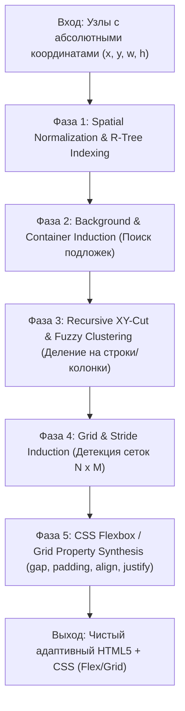

# 📐 Движок синтеза адаптивной верстки (Layout Synthesis Engine)
## Автоматическая трансформация абсолютных координат Figma в чистый Flexbox и CSS Grid

> **Цель проекта**: Полный отказ от `position: absolute` при декомпиляции макетов Figma, созданных **без использования Auto Layout**. Автоматический анализ геометрии, интеллектуальная группировка элементов в секции, строки, колонки и сетки с генерацией поддерживаемого, семантического и адаптивного HTML5/CSS3.

---

## 1. Проблема и мотивация

При экспорте макетов Figma, где дизайнер не настроил Auto Layout:
- Все слои хранятся плоским списком с абсолютными координатами `(x, y, width, height)`.
- Традиционные конвертеры транслируют это «в лоб» в `position: absolute; left: 120px; top: 450px;`, что непригодно для продакшена:
  - Верстка ломается при изменении контента, локализации или размера шрифта.
  - Полностью отсутствует адаптивность под разные разрешения экранов (Responsive / Fluid).
  - Код невозможно поддерживать разработчикам.

**Layout Synthesis Engine** решает эту проблему алгоритмически: анализирует взаимное пространственное расположение элементов и синтезирует полноценное гибкое дерево компонентов (Flexbox rows/columns и CSS Grid) на лету.

---

## 2. Архитектура и этапы алгоритма

Конвейер обработки состоит из 5 последовательных геометрических фаз:



---

### Фаза 1. Пространственная нормализация и индексация (Spatial Indexing)
1. Для каждого слоя вычисляется глобальный и локальный Bounding Box:
   $$B = [x_{\min}, y_{\min}, x_{\max}, y_{\max}]$$
2. Создается пространственный 2D-индекс (**R-Tree** или Interval Tree) для быстрого поиска пересечений и включений за $O(\log N)$.
3. Разрешаются z-index наложения и порядок следования элементов.

---

### Фаза 2. Извлечение контейнеров и подложек (Background Separation)
В обычном дизайне карточки и секции часто представлены обычными прямоугольниками (`RECTANGLE` или плоскими `FRAME`), подложенными под текст и иконки.

1. **Детекция вмещающих подложек**:
   - Если прямоугольник $A$ имеет визуальные свойства (заливка `fillPaints`, обводка `strokePaints`, скругления `cornerRadius` или тени `effects`), не имеет собственных дочерних узлов в Figma, но **геометрически охватывает** группу элементов $\{B_1, B_2, \dots, B_k\}$ с погрешностью $\le 3\text{px}$:
     - Элемент $A$ повышается до **контейнера (Semantic Container Frame)**.
     - Элементы $\{B_i\}$ удаляются из родительского плоского списка и становятся дочерними элементами контейнера $A$.
     - Стили подложки $A$ трансформируются в `background`, `border-radius`, `box-shadow` контейнера.
2. **Изоляция декоративных оверлеев (Floating Overlays / Badges)**:
   - Если элемент перекрывает границу контейнера лишь частично (например, крестик закрытия модалки, плашка скидки на углу карточки, бейдж уведомлений), он маркируется как `DECORATIVE_OVERLAY` и сохраняет локальный `position: absolute` с привязкой к углу родителя, не ломая потоковую верстку остальных элементов.

---

### Фаза 3. Рекурсивное пространственное разделение (Recursive XY-Cut)

Ядро алгоритма — адаптированный для веб-верстки метод рекурсивного ортогонального разрезания:

1. **Построение профилей проекций (1D Projection Profiles)**:
   - Строится гистограмма занятости пространства по оси $Y$ (вертикальная проекция) и по оси $X$ (горизонтальная проекция).
2. **Поиск разделительных полос (Gap Slicing)**:
   - Ищутся пустые интервалы, в которых нет ни одного элемента.
   - Если проекция на ось $Y$ разделяется пустыми горизонтальными полосами:
     - Блок классифицируется как **Вертикальный стек (`flex-direction: column`)**.
     - Каждая непустая полоса становится отдельным дочерним рядом.
   - Если элементы в полосе не перекрываются по горизонтали:
     - Ряд классифицируется как **Горизонтальный стек (`flex-direction: row`)**.
3. **Fuzzy Tolerance Clustering (Нечеткое выравнивание)**:
   - Дизайнеры допускают неточности в 1–3 пикселя (например, иконка стоит на 1px выше базовой линии текста).
   - Вводится порог толерантности $\epsilon = 3\text{px}$.
   - Элементы, чьи границы или центры отличаются на величину $\le \epsilon$, считаются строго выровненными:
     - $|\text{center}_y(A) - \text{center}_y(B)| \le \epsilon \implies \text{align-items: center}$.
     - $|y_{\min}(A) - y_{\min}(B)| \le \epsilon \implies \text{align-items: flex-start}$.
4. Шаг рекурсивно повторяется для каждого выделенного подконтейнера до атомарных узлов.

---

### Фаза 4. Распознавание сеток (Grid & Matrix Induction)

Если контейнер содержит группу однородных элементов (карточки, галереи, список фичей):
1. Вычисляется количество строк $R$ и столбцов $C$.
2. Проверяется регулярность шага:
   - Одинаковая ширина колонок $W_i \approx W$.
   - Равномерные горизонтальные отступы $\Delta X_i \approx \Delta X$.
   - Равномерные вертикальные отступы $\Delta Y_i \approx \Delta Y$.
3. При совпадении паттерна группа синтезируется не как каскад вложенных флекс-строк, а как единая чистая CSS-сетка:
   ```css
   display: grid;
   grid-template-columns: repeat(C, 1fr);
   column-gap: ΔXpx;
   row-gap: ΔYpx;
   ```

---

### Фаза 5. Синтез CSS-свойств контейнеров (Flexbox/Grid Property Synthesis)

На основе геометрии вычисляются окончательные CSS-правила:
- **Внутренние отступы (`padding`)**:
  - $\text{padding-top} = \min(child.y) - container.y$
  - $\text{padding-left} = \min(child.x) - container.x$
  - $\text{padding-right} = (container.x + container.w) - \max(child.x + child.w)$
  - $\text{padding-bottom} = (container.y + container.h) - \max(child.y + child.h)$
- **Промежутки между элементами (`gap`)**:
  - Медиана расстояний между соседними элементами в строке или колонке.
- **Главная ось (`justify-content`)**:
  - Элементы прижаты к началу $\to$ `flex-start`.
  - Элементы разнесены по краям $\to$ `space-between`.
  - Элементы симметрично сгруппированы по центру $\to$ `center`.
- **Поведение размеров (`width`, `flex-grow`, `align-self`)**:
  - Элемент занимает всю ширину контейнера (за вычетом паддингов) $\to$ `width: 100%` или `align-self: stretch`.
  - Маленькие фиксированные элементы (кнопки, иконки, бейджи) $\to$ Hug-контент / `flex-shrink: 0`.

---

## 3. Пошаговый план внедрения в проект

### Этап 1. Геометрическое ядро (`src/decompiler/geometry.js`)
- [x] Класс `BoundingBox` и утилиты пересечения, объединения, проекций на оси.
- [x] 1D-интервальное дерево и кластеризация с порогом толерантности $\epsilon$.
- [x] Unit-тесты на геометрические операции (20+ тестов).

### Этап 2. Детектор подложек и контейнеров (`src/decompiler/container-detector.js`)
- [x] Поиск объемлющих прямоугольников (Background Cards).
- [x] Перенос стилей подложки на синтезируемый контейнер.
- [x] Выявление декоративных плавающих элементов (`DECORATIVE_OVERLAY`).

### Этап 3. Рекурсивный синтезатор дерева (`src/decompiler/synthesizer.js`)
- [x] Реализация рекурсивного алгоритма `recursiveXYCut(nodes, containerBounds)`.
- [x] Создание виртуальных фреймов `type: 'FRAME'` с нативным `stackMode: 'HORIZONTAL' | 'VERTICAL'`.
- [x] Индукция сеток `display: grid` для $N \times M$ матриц.

### Этап 4. Интеграция в существующий конвейер декомпилятора
- [x] Подключение пре-процессора в `src/decompiler/index.js` и `src/decompiler/tree.js`.
- [x] Если `node.stackMode === 'NONE'` и у фрейма $> 1$ потомка $\to$ запуск `synthesizeLayoutTree(node)`.
- [x] Бесшовная передача синтезированных Auto Layout узлов в готовые модули `src/decompiler/css.js` и `src/decompiler/html.js`.
- [x] CLI-флаги `--smart-layout` (по умолчанию включен) и `--no-smart-layout` (для отката к `absolute`).

### Этап 5. Тестирование и верификация
- [x] End-to-End тест на макетах без единого Auto Layout фрейма.
- [x] Регрессионное тестирование: проверка сохранения 100% прохождения существующих 61 тестов.
- [x] Проверка качества верстки на реальных коммерческих дизайнах (лендинги, карточки, панели).

### Этап 6. Документация и обновление README.md
- [x] Описать возможности и работу движка Smart Layout Synthesis в `README.md`.
- [x] Документировать новые CLI-флаги (`--smart-layout` и `--no-smart-layout`) в таблице и примерах `README.md`.
- [x] Добавить наглядные примеры декомпиляции макетов без Auto Layout в чистый Flexbox/Grid.
- [x] Обновить счетчик пройденных тестов и бейджи в `README.md`.

---

## 4. Ожидаемый результат

1. Любой макет Figma (даже нарисованный хаотично без единого Auto Layout) автоматически экспортируется в чистый, человекопонятный HTML5 с семантическими блоками.
2. Отсутствие хрупкого `position: absolute` для основного потока страницы.
3. Полная адаптивность верстки при изменении размера экрана или масштабировании текста.
