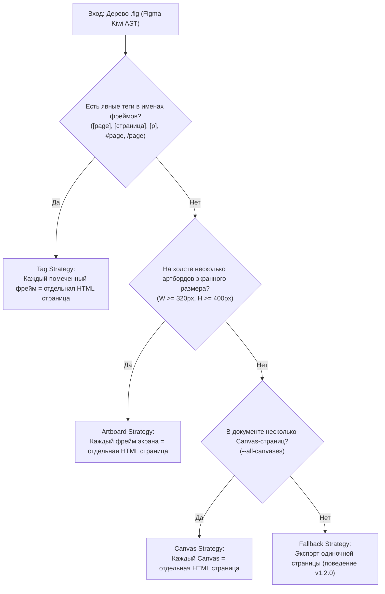
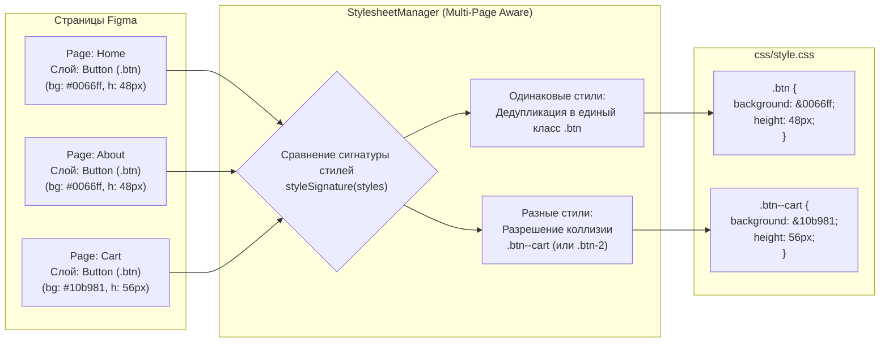

# 🌐 Спецификация Figma Multi-Page Import Engine (v1.3.0)
## Автоматический импорт многостраничных проектов из Figma в структурированный HTML/CSS сайт

> **Цель версии 1.3.0**: Реализация поддержки **полноценного многостраничного экспорта** (.fig ➔ Мультистраничный HTML-сайт). Возможность за один вызов команды декомпилировать проект из Figma, содержащий множество страниц или артбордов, формируя чистую структуру `index.html`, `about.html`, `catalog.html` с **единым оптимизированным файлом стилей `css/style.css`**, дедуплицированным пулом ассетов и гарантией **100% отсутствия конфликтов CSS-стилей** при одинаковых названиях слоев в Figma.

---

## 1. Проблема и требования

В текущей версии (v1.2.0) декомпилятор обрабатывает один Canvas или первый верхнеуровневый фрейм и генерирует одиночный файл `index.html`. 

В реальных веб-проектах дизайнеры Figma создают сайты следующим образом:
1. **Несколько верхнеуровневых фреймов-экранов на одном холсте** (например, `[page] Home`, `[page] About`, `[page] Pricing` или `Index`, `Catalog`, `Product`, `Cart`).
2. **Несколько страниц в левой панели Figma** (нативные `CANVAS` узлы в Kiwi AST: «Landing», «Dashboard», «Settings»).
3. **Общие компоненты и одинаковые имена слоев с разными стилями**:
   - На странице `Home` кнопка `.btn` синяя с высотой 48px, а на странице `Checkout` кнопка с тем же названием `.btn` зеленая с высотой 56px.
   - Если объединить их в один общий CSS файл без изоляции коллизий, произойдет перезапись стилей (CSS clash), что сломает верстку на одной из страниц.
   - В то же время, элементы с **полностью одинаковыми параметрами** (шапка, подвал, логотипы, типографика) **должны переиспользоваться**, соблюдая принцип DRY (Don't Repeat Yourself) и минимизируя итоговый вес бандла.

---

## 2. Стратегия обнаружения страниц (Page Detection Engine)

Движок должен поддерживать гибкую трехуровневую эвристику детекции страниц в модуле `src/decompiler/page-detector.js`:



### 2.1. Стратегия 1: Явные теги страниц (Explicit Tags) — наивысший приоритет
- Если хотя бы один верхнеуровневый фрейм содержит префикс/тег:
  - `[page]`, `[страница]`, `[p]`, `#page`, `/page`
- Движок извлекает только тегированные фреймы, игнорируя черновики, палитры цветов, заметки и вынесенные компоненты.
- **Именование страниц**:
  - `[page] Home` или `[страница] Главная` ➔ `index.html`
  - `[page] About Us` или `[страница] О компании` ➔ `about-us.html` (или `o-kompanii.html` через таблицу транслитерации `RU_MAP`)
  - `[page] 404` ➔ `404.html`

### 2.2. Стратегия 2: Экранные артборды (Screen Artboards)
- Если тегов нет, движок анализирует верхнеуровневые фреймы холста:
  - Фильтрует по минимальным габаритам экрана (по умолчанию: `width >= 320px`, `height >= 400px`).
  - Фреймы, отсортированные по координате $X$ (слева направо) или $Y$, становятся страницами.
  - Первый экран или экран с именем `Home` / `Index` / `Main` / `Desktop` становится `index.html`, остальные — `<slug>.html`.

### 2.3. Стратегия 3: Нативные страницы Figma (Canvas Pages)
- При указании флага `--all-canvases` или `--all-pages` движок декомпилирует все вкладки страниц Figma документа.

---

## 3. Архитектура общего CSS и предотвращение конфликтов (CSS Collision Isolation)

Для реализации единого файла стилей `css/style.css` при экспорте с флагом `-s` модернизируется `src/decompiler/stylesheet.js`.



### 3.1. Интеллектуальная дедупликация (Smart DRY CSS)
- Если на разных страницах слои имеют одинаковое имя и **идентичный набор CSS-свойств**:
  - Им присваивается общий класс (например, `.btn`, `.header`, `.footer`, `.card`).
  - В `css/style.css` создается **одно общее правило**.
  - Это минимизирует размер CSS файла и ускоряет загрузку страниц в браузере.

### 3.2. Разрешение коллизий при различающихся параметрах (Conflict Resolution)
- Если на странице `Cart` слой называется `.btn`, но его цвет, отступы или размеры отличаются от `.btn` на странице `Home`:
  - Движок детектирует коллизию: базовое имя совпадает, но `styleSignature(styles)` отличается.
  - Автоматически применяется детерминированное разрешение конфликта:
    1. **Страничный модификатор**: `.btn--cart` (или `.btn-cart`), связывающий селектор со страницей.
    2. **Контекстный селектор страницы**: на теге `<body>` каждой страницы указывается класс страницы:
       `<body class="page-home">` и `<body class="page-cart">`.
       Конфликтующее правило оформляется как `.page-cart .btn` либо `.btn--cart`.
    3. **Альтернативный вариант**: прогрессивный числовой суффикс `.btn-2`, сохраняемый детерминированно в реестре.
- Ни одно правило не перезаписывает другое!

### 3.3. Разделение параметров `.main-container`
- Для каждой страницы создается корневой контейнер с базовым классом `.main-container`:
  - Общие стили контейнера: `width: 100%; margin: 0 auto; box-sizing: border-box;`.
  - Уникальные стили страницы (разные `max-width`, разный фон `background`, индивидуальные padding):
    `<div class="main-container page-home-container">`
    `<div class="main-container page-about-container">`

### 3.4. Глобальные токены `:root` и единый пул ассетов
- Цвета, шрифты, радиусы и Figma Variables со всех страниц объединяются в единую секцию `:root`.
- Реестр изображений (`imageRegistry`) дедуплицирует блобы по SHA-1 хешу: если один и тот же логотип или фото используется на 10 страницах, файл в `dist/img/` сохраняется ровно один раз.

---

## 4. Структура файлового вывода

### При экспорте с разделением файлов (`-s / --separate-files`):
```text
dist/
├── index.html              <-- <link rel="stylesheet" href="css/style.css">
├── about.html              <-- <link rel="stylesheet" href="css/style.css">
├── catalog.html            <-- <link rel="stylesheet" href="css/style.css">
├── contact.html            <-- <link rel="stylesheet" href="css/style.css">
├── css/
│   └── style.css           <-- ЕДИНЫЙ оптимизированный CSS файл для ВСЕХ страниц
└── img/
    ├── logo.webp
    ├── hero-home.webp
    └── ...                 <-- ЕДИНЫЙ оптимизированный пул изображений
```

### При автономном экспорте (без `-s`):
```text
dist/
├── index.html              <-- Автономный HTML со встроенным CSS для страницы 1
├── about.html              <-- Автономный HTML со встроенным CSS для страницы 2
└── catalog.html            <-- Автономный HTML со встроенным CSS для страницы 3
```

---

## 5. Новые CLI опции для `fig-to-html` (v1.3.0)

| Флаг / Опция | Тип | По умолчанию | Описание |
|---|---|---|---|
| `--multi-page` | `boolean` | `true` (auto) | Включить многостраничный режим декомпиляции при наличии нескольких страниц/тегов. |
| `--single-page` | `boolean` | `false` | Принудительно экспортировать только одну (первую/указанную) страницу. |
| `--page-tag <tag>` | `string` | `"[page],[страница]"` | Кастомный тег или список тегов в названии фреймов для маркировки страниц. |
| `--pages <names>` | `string` | `null` | Список конкретных страниц/фреймов для экспорта через запятую (например, `"Home, About, Pricing"`). |
| `--all-canvases` | `boolean` | `false` | Экспортировать все Canvas-вкладки документа Figma как отдельные страницы. |
| `--min-page-width <px>` | `number` | `320` | Минимальная ширина фрейма на холсте для признания его отдельной страницей. |
| `--class-scope <mode>` | `string` | `"modifier"` | Режим изоляции конфликтующих классов: `modifier` (`.btn--about`), `scoped` (`.page-about .btn`), или `numbered` (`.btn-2`). |

---

## 6. Независимость и совместимость с режимами верстки

Многостраничный импорт должен бесшовно и независимо работать со всеми существующими подсистемами:
1. **Smart Layout Synthesis**: автоматическая адаптивная группировка в Flexbox и CSS Grid для каждой страницы индивидуально.
2. **Fluid Responsive (`--fluid`)**: адаптивные `clamp()`, `vw/vh` единицы рассчитываются от ширины холста конкретной страницы.
3. **Оптимизация изображений**: Retina 2x, WebP, AVIF, lossless компрессия и responsive srcset.
4. **CSS Variables & Design Tokens (`--tokens`)**: сбор токенов со всего проекта в единый JSON файл `dist/tokens.json`.

---

## 7. План реализации и контрольные тесты

1. **Модуль детекции страниц**: `src/decompiler/page-detector.js` (юнит-тесты на теги, артборды, размеры, санитизацию URL).
2. **Мультистраничное дерево**: адаптация `buildSceneTree` в `src/decompiler/tree.js` для итерации по набору целевых страниц.
3. **Многостраничный `StylesheetManager`**: поддержка контекста страницы, дедупликация совпадающих стилей и изолирование коллизий в `src/decompiler/stylesheet.js`.
4. **Конвейер декомпиляции**: обновление `decompileFig` в `src/decompiler/index.js` для сохранения коллекции HTML-файлов и общего CSS.
5. **CLI интеграция**: обновление `cli-reverse.js` с новыми аргументами и отображением прогресса по страницам `(Page 1/3: index.html...)`.
6. **Набор тестов**:
   - Юнит-тесты на детекцию страниц и санитизацию имен файлов.
   - Тест на дедупликацию одинаковых стилей между страницами.
   - Тест на разрешение конфликтов стилей при одинаковых именах слоев.
   - End-to-end тест на декомпиляцию многостраничного `.fig` макета с генерацией сайта `dist/*.html` + `dist/css/style.css`.
