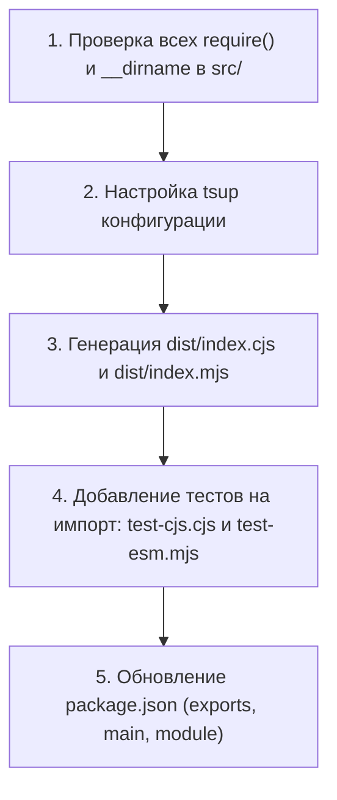

# 🗺️ Roadmap: Модульная система Dual CommonJS & ES Modules (CJS / ESM)

## 1. Контекст и цели
В экосистеме современного JavaScript произошёл фундаментальный переход на **ES Modules (ESM)**:
* Большинство новых инструментов (Vite, Next.js App Router, Astro, SvelteKit, Bun, Deno) работают с ESM нативно.
* Современные версии зависимостей (например, свежие мажорные версии `jsdom`, `chalk`, `node-fetch`, `execa`) являются *ESM-only*.
* Сейчас `figmatik` использует формат CommonJS (`require()`, `module.exports`). Если пользователь в ESM-проекте пишет `import { convertFigToHtml } from 'figmatik'`, Node.js вынужден использовать CJS-интероп, который иногда вызывает проблемы с tree-shaking и разрешением путей.

### Цель:
Превратить `figmatik` в **гибридный Dual Package**, который одновременно и без оверхеда поддерживает:
1. `import { convertFigToHtml } from 'figmatik'` (ESM).
2. `const { convertFigToHtml } = require('figmatik')` (CJS).
3. Прямой запуск CLI `npx figmatik` и `npx fig2html`.

---

## 2. Архитектура Dual Package

### 2.1 Настройка `package.json`
Использование современного поля `"exports"`:

```json
{
  "name": "figmatik",
  "version": "1.6.0",
  "type": "commonjs",
  "main": "./dist/index.cjs",
  "module": "./dist/index.mjs",
  "types": "./dist/index.d.ts",
  "bin": {
    "figmatik": "./bin/figmatik.cjs",
    "fig2html": "./bin/fig2html.cjs",
    "html-to-fig": "./bin/figmatik.cjs"
  },
  "exports": {
    ".": {
      "types": "./dist/index.d.ts",
      "import": "./dist/index.mjs",
      "require": "./dist/index.cjs"
    },
    "./package.json": "./package.json"
  }
}
```

### 2.2 Пайплайн сборки через `tsup`
Для предотвращения дублирования кодовой базы и ручной поддержки двух веток кода используется `tsup`:

```javascript
// tsup.config.ts
import { defineConfig } from 'tsup';

export default defineConfig({
  entry: ['src/index.ts'],
  format: ['cjs', 'esm'],
  dts: true,
  splitting: false,
  sourcemap: true,
  clean: true,
  shims: true, // автоматически подставляет __dirname и __filename для ESM
  target: 'node18'
});
```

### 2.3 Особенности миграции: `__dirname` и `__filename`
В CommonJS активно используются `__dirname` и `path.resolve(__dirname, '../templates/template.fig')`.
В нативном ESM `__dirname` отсутствует.
Для решения этой проблемы в ESM-бандле используется стандартный полифил:
```javascript
import { fileURLToPath } from 'url';
import { dirname } from 'path';

const __filename = fileURLToPath(import.meta.url);
const __dirname = dirname(__filename);
```
Флаг `shims: true` в `tsup` инжектирует этот код автоматически при сборке `.mjs` файла, сохраняя 100% совместимость.

---

## 3. План реализации



| Этап | Содержание | Критерий готовности |
|---|---|---|
| **Этап 1** | Настройка `tsup` сборщика | Успешная сборка `dist/index.mjs` и `dist/index.cjs` |
| **Этап 2** | Создание тестов интеграции модулей | `node test/test-esm.mjs` и `node test/test-cjs.cjs` успешно выполняют конвертацию |
| **Этап 3** | Обновление `bin/` скриптов | CLI-утилиты корректно запускаются в средах с `"type": "module"` и `"type": "commonjs"` |
