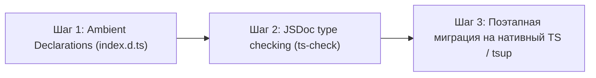

# 🗺️ Roadmap: Внедрение TypeScript и деклараций типов (.d.ts)

## 1. Контекст и цели
В текущей версии проект `figmatik` полностью написан на JavaScript (CommonJS).
При использовании `figmatik` в современных фронтенд-проектах (Next.js, Vite, Astro, Remix) и корпоративных дизайн-системах, разработчики сталкиваются с отсутствием автодополнения (IntelliSense), строгой проверки параметров и типов структур AST Figma/HTML.

### Цели внедрения:
1. **Первоклассный DX (Developer Experience)**: полное автодополнение всех параметров CLI и programmatic API в VS Code, WebStorm и других IDE.
2. **Типобезопасность структур AST**: типы для `NodeChange`, `BoundingBox`, `Breakpoint`, `DesignToken`, `FigmatikOptions`.
3. **Бесшовная интеграция**: поддержка проектов на TypeScript без необходимости объявлять собственный `declare module "figmatik"`.

---

## 2. Стратегия реализации в 2 шага



### Шаг 1: Добавление официального `index.d.ts` (Immediate DX win)
Создание файла декларации типов в корне проекта без изменения исходного JS-кода:

```typescript
// index.d.ts
export interface FigToHtmlOptions {
    /** Output directory or HTML file path */
    outputHtmlPath?: string;
    /** Canvas/page name in Figma to decompile (default: "Page 1") */
    pageName?: string;
    /** Enable multi-page export mode (default: true) */
    multiPage?: boolean;
    /** Force single page export */
    singlePage?: boolean;
    /** Extract external CSS and images instead of self-contained HTML */
    separateFiles?: boolean;
    /** Format for images: 'original' | 'webp' | 'avif' (default: 'original') */
    imageFormat?: 'original' | 'webp' | 'avif';
    /** Layout strategy: 'default' | 'relative' | 'fluid' | 'grid' */
    layoutMode?: 'default' | 'relative' | 'fluid' | 'grid';
    /** Synthesize clean Flexbox & Grid without absolute positioning (default: true) */
    smartLayout?: boolean;
    /** Generate primitive :root spacing tokens (default: true) */
    spacingTokens?: boolean;
    /** Responsive merge into single adaptive page with clamp() */
    responsive?: boolean;
    /** Custom breakpoint target widths (e.g. [1440, 768, 375]) */
    breakpoints?: number[] | string;
    /** Custom document title */
    title?: string;
    /** Print verbose execution logs */
    verbose?: boolean;
    /** Progress callback (0-100%, message) */
    onProgress?: (percent: number, message: string) => void;
}

export interface FigToHtmlResult {
    html: string;
    css: string | null;
    outputPath: string | null;
    cssPath: string | null;
    assetsDir: string | null;
    totalNodes: number;
    imagesCount: number;
    durationMs: number;
    stats: {
        frames: number;
        textNodes: number;
        images: number;
        shapes: number;
    };
    isMultiPage?: boolean;
    pages?: Array<{
        name: string;
        fileName: string;
        html: string;
    }>;
}

export interface HtmlToFigOptions {
    htmlPath?: string;
    htmlContent?: string;
    outputPath?: string;
    templatePath?: string;
    pageName?: string;
    allowRemoteImages?: boolean;
    allowExternalPaths?: boolean;
    allowPrivateHosts?: boolean;
    verbose?: boolean;
    onProgress?: (percent: number, message: string, step?: string) => void;
}

export interface HtmlToFigResult {
    outputPath: string;
    fileSizeBytes: number;
    generatedNodes: number;
    durationMs: number;
    stats: {
        frames: number;
        textNodes: number;
        images: number;
        shapes: number;
    };
}

/** Converts a Figma .fig binary file into responsive HTML/CSS */
export function convertFigToHtml(
    figInput: string | Buffer,
    options?: FigToHtmlOptions
): Promise<FigToHtmlResult>;

/** Generates a native Figma .fig file from an HTML document or string */
export function generateFigFile(
    options: HtmlToFigOptions
): Promise<HtmlToFigResult>;

/** Internal Scene Tree & Parser APIs */
export function readFigFile(figInput: string | Buffer): {
    nodeChanges: any[];
    blobs: Buffer[];
    images: Map<string, any>;
};
```

В `package.json` добавляется поле:
```json
"types": "index.d.ts"
```

---

### Шаг 2: Включение проверки типов через `jsconfig.json` / `tsconfig.json`
* Добавление `checkJs: true` для статической верификации типов по существующим JSDoc-комментариям в исходниках без шага сборки (`tsc --noEmit`).
* Это позволит отлавливать `null/undefined` ошибки во время CI-сборки.

---

### Шаг 3: Полная миграция на TypeScript и компилятор `tsup`
* Перевод исходников в `src/**/*.ts`.
* Использование легковесного бандлера `tsup` (на базе esbuild) для мгновенной сборки без оверхеда:
  - Формирование CommonJS (`dist/index.cjs`).
  - Формирование ESM (`dist/index.mjs`).
  - Формирование типов (`dist/index.d.ts`).
